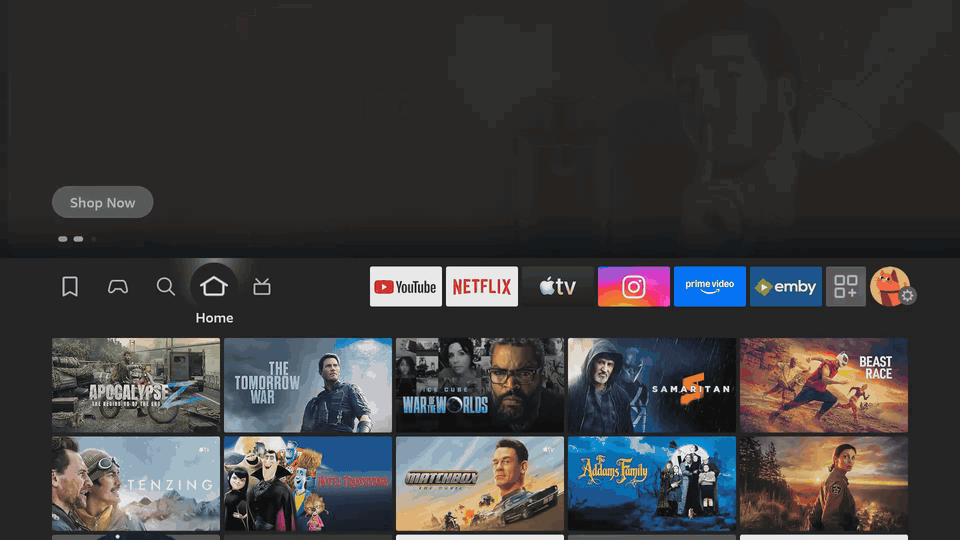
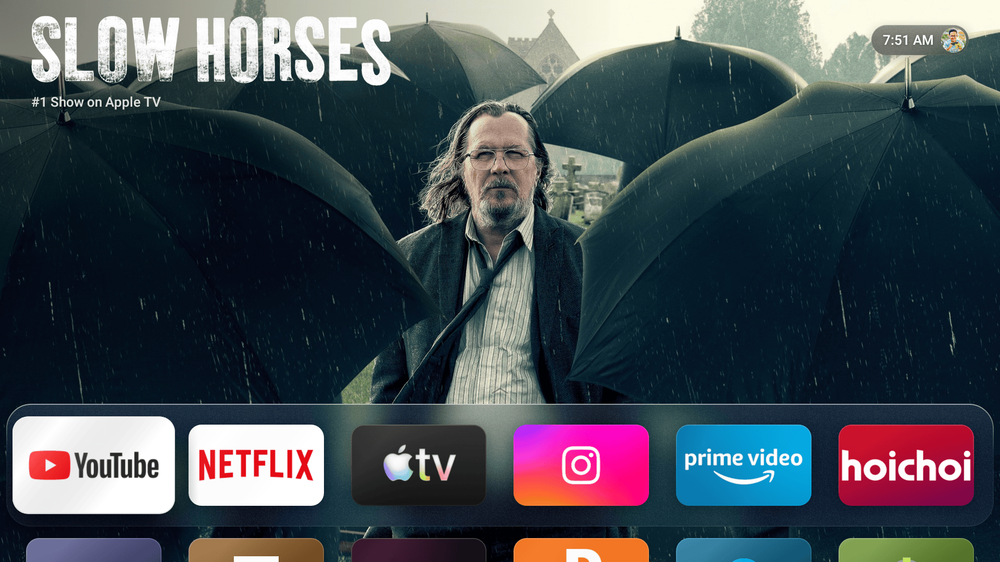
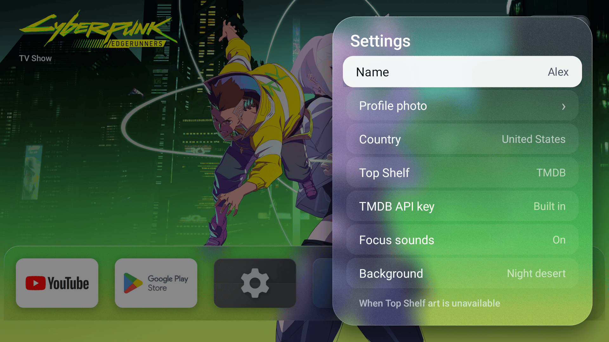
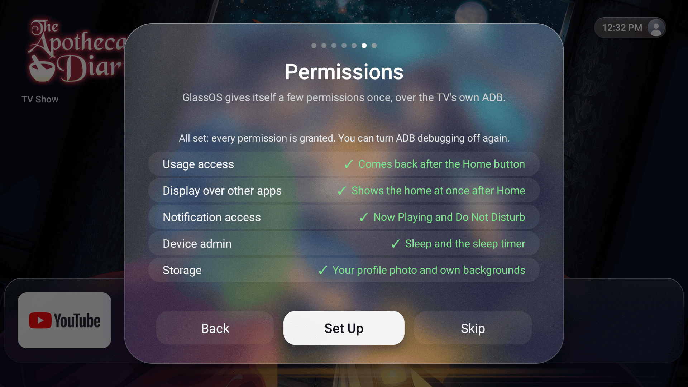
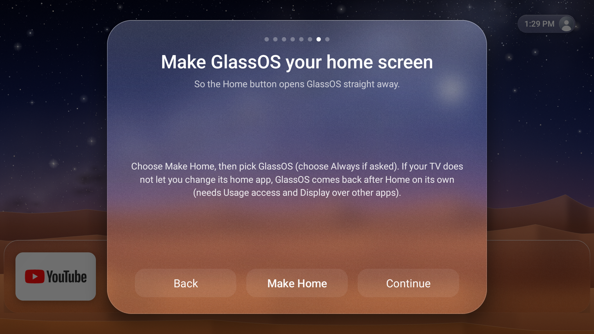

# GlassOS for Android TV and Fire TV

A calm, glassy home screen for Android TV, Google TV and Amazon Fire TV, inspired by tvOS. GlassOS gives your TV a
rotating Top Shelf of what is trending on your streaming services, a frosted shelf of your favourite apps, a full
app drawer and a Control Center, all driven with the remote's D-pad.

GlassOS is free software under the GNU GPL v3.



## Screenshots



| | |
|---|---|
|  |  |
| Control Center (Menu) | Settings |
|  |  |
| First-run setup, one-tap permissions | Android TV: make GlassOS your home screen |

Home and Control Center are from a Fire TV Stick 4K using the Apple TV (unofficial) Top Shelf source. TMDB is the
default source and looks the same, with trending titles from your own streaming apps. Settings and setup were taken
on the Android TV emulator.

## Features

- **Top Shelf**: full-screen art of trending series and films, with title logos. Titles on the streaming apps you
  have installed (Netflix, Prime Video, Disney+, Apple TV+, Max and others) come first, for the country you
  choose. OK on a title opens its app.
- **Glass shelf**: up to six favourite apps on a frosted glass shelf, with the first row of the app drawer peeking
  in below it. Long press OK on any app to add it to the top row or remove it; Settings > Edit top row moves them.
- **App drawer**: every installed app, with labels, a scroll below the shelf.
- **Adaptive profile pill**: the time and your avatar in the top right, with a tint that adapts to the art behind it.
- **Control Center** (Menu, or OK on the pill): Sleep, Wi-Fi, Do Not Disturb, Audio, a sleep timer, Controllers,
  Accessibility, Parental Controls (Fire TV), Now Playing (while something plays) and VPN (while a VPN is on). On
  Android TV the buttons open the standard Settings pages.
- **Your Home button**: on Android TV GlassOS can be the default home app. Where the TV does not allow that (Fire TV,
  and Android TV or Google TV builds that keep their own home), GlassOS notices the stock home and covers it, so
  the Home button still lands in GlassOS.
- **Starts at boot**, with the Fire TV boot logo handled correctly.
- **First-run setup**: ABC or QWERTY keyboard, your name (on-screen keyboard), an optional profile photo, your country, your top-row apps,
  one-tap permissions and, on Android TV, a "Make GlassOS your home screen" step.
- Built-in procedural scenes (night desert, dusk ocean, aurora, dark) when there is no network, or your own
  photos from the Pictures/Glass folder.

## Install

GlassOS is not in Google Play or the Amazon Appstore. Download `GlassOS-v1.0.1-beta.apk` from the
[Releases](https://github.com/AbhishekKaisar/glassos-tv/releases) page.

### Android TV and Google TV

1. Allow installs from your installer app: Settings > Device Preferences > Security & restrictions > Unknown
   sources (on Google TV: Settings > System > Apps > Security & restrictions > Unknown sources), and turn it on
   for the app you use below.
2. Install with one of:
   - **Downloader** (by AFTVnews, in Google Play): enter the APK's URL from the Releases page.
   - **Send Files to TV**: send the APK from your phone, then open it on the TV.
   - **adb from a computer** (see below).
3. Open GlassOS. Setup starts on its own.

### Fire TV

1. Settings > My Fire TV > Developer options: turn on **Apps from Unknown Sources** (or, on newer Fire OS,
   **Install unknown apps** for Downloader). No Developer options? Open Settings > My Fire TV > About and press OK
   on your device name 7 times.
2. Install **Downloader** from the Appstore, open it and enter the APK's URL from the Releases page.
3. Install, then open GlassOS. Setup starts on its own.

### With adb from a computer

```sh
adb connect <tv-ip>:5555
adb install GlassOS-v1.0.1-beta.apk
adb shell am start -n io.github.abhishekkaisar.glassos/.MainActivity
```

## Set it up with an AI coding agent

Not comfortable with adb? Open an AI coding agent (Claude Code, Codex, Cursor, Gemini CLI and similar) on your
computer and tell it:

> Set up GlassOS on my TV using AGENTS.md from github.com/AbhishekKaisar/glassos-tv

[AGENTS.md](AGENTS.md) walks the agent through it step by step: it asks which TV you have, helps you turn on
debugging, installs only adb and the signature-checked GlassOS APK, and explains each step first.

## Set GlassOS as your home screen

### Android TV and Google TV

In setup (or GlassOS Settings > Home screen) choose **Make Home**. GlassOS tries, in order: the system's "Set
GlassOS as your default home app?" prompt, the Default home app page in Settings, and finally
`cmd package set-home-activity` over the TV's own ADB. If Home then opens GlassOS, the step shows a tick and no
watcher runs at all.

Many Android TV and Google TV builds keep their own home no matter what is chosen: the stock launcher's Home entry
outranks any other app's, so the setting changes but Home still opens the stock home. GlassOS detects that and falls
back to the watcher (Usage access and Display over other apps, below), which brings GlassOS back after Home.

Advanced, at your own risk: if you want Home to open GlassOS directly on such a TV, you can turn off the stock
launcher from a computer. Undo it before uninstalling GlassOS, or the TV has no home screen.

```sh
# Google TV: com.google.android.apps.tv.launcherx   Android TV: com.google.android.tvlauncher
adb shell pm disable-user --user 0 com.google.android.tvlauncher
# undo
adb shell pm enable com.google.android.tvlauncher
```

### Fire TV

Fire OS does not let apps replace its home. GlassOS watches for the Fire TV home and covers it, which needs Usage
access and Display over other apps. Settings > Replace Fire TV home turns this on or off.

## One-tap permission setup

A few features need permissions that only ADB can grant. GlassOS can grant them to itself, once, using the TV's own
ADB:

1. Turn on debugging:
   - **Fire TV**: Settings > My Fire TV > Developer options > **ADB debugging**.
   - **Android TV / Google TV**: Settings > Device Preferences > About, press OK on **Build** 7 times. Then Device
     Preferences > Developer options > **USB debugging** (and **Network debugging** where the TV has it).
2. In GlassOS setup (or Settings > Permissions), choose **Set Up**.
3. The TV asks "Allow USB debugging?". Tick **Always allow from this computer** and choose **Allow**.

GlassOS connects to `127.0.0.1:5555` with its own key, runs the grant commands on itself and shows a tick next to
each permission. You can turn debugging off again afterwards.

On Android 11 and later, **Wireless debugging** uses pairing codes and a random port, so it does not open port 5555.
If GlassOS says the connection was refused, use the manual grants from a computer below (after `adb pair` and
`adb connect` as the TV's Wireless debugging screen shows), or connect once over USB and run `adb tcpip 5555`.

On Fire TV, Fire OS updates since 2024 (7.6.6.9, 8.1.0.3 and late Fire OS 6) block apps from using the TV's own ADB, so
setup says the Fire TV closed its ADB to GlassOS. Run these from a computer instead: the [manual grants](#manual-grants)
after `adb connect <tv-ip>:5555`.

Every feature works without its permission, with less:

| Permission | Used for | Without it |
|---|---|---|
| Usage access | Noticing the stock home after the Home button (not needed when GlassOS is the default home) | Home goes to the stock home; open GlassOS from your apps |
| Display over other apps | Showing GlassOS at once after Home | GlassOS still comes back, a moment later |
| Notification access | Now Playing and Do Not Disturb | Those tiles are hidden or open the TV's settings |
| Device admin | Sleep and the sleep timer | Fire TV: Sleep opens the Fire TV sleep menu. Android TV: Sleep is unavailable |
| Storage | Your profile photo and own backgrounds | The glass avatar and built-in scenes |

GlassOS reads no notifications: notification access is only how Android lets an app see media sessions.

### Manual grants

If you prefer a computer, these are the same grants, for both platforms:

```sh
P=io.github.abhishekkaisar.glassos
adb shell appops set $P GET_USAGE_STATS allow
adb shell appops set $P SYSTEM_ALERT_WINDOW allow
adb shell cmd notification allow_listener $P/$P.MediaListener
adb shell dpm set-active-admin $P/.AdminReceiver
adb shell pm grant $P android.permission.READ_EXTERNAL_STORAGE
# Android TV only: make GlassOS the default home app (Android 7 and later)
adb shell cmd package set-home-activity $P/.MainActivity
```

That notification command is for Android 8 and later (Fire OS 7 and later). On Fire OS 5 and 6 use
`adb shell settings put secure enabled_notification_listeners $P/$P.MediaListener` instead, and if another app
already has notification access, append to the list with a colon rather than replacing it (check first with
`adb shell settings get secure enabled_notification_listeners`).

## Top Shelf sources

Choose in Settings > Top Shelf:

- **TMDB** (default): trending titles from [TMDB](https://www.themoviedb.org/), preferring those on your installed
  streaming services in your country. Refreshed at most every 6 hours and cached for offline use.
- **Apple TV (unofficial)**: the featured titles of the Apple TV app's web catalogue. Unofficial and off by default;
  it may stop working at any time.
- **Built-in scenes**: no network at all.

When a source has no art (no network, no key), the background chosen under "When Top Shelf art is unavailable" is
shown.


This product uses the TMDB API but is not endorsed or certified by TMDB. Streaming availability comes from TMDB's
watch provider data (powered by JustWatch).

### Building with your own TMDB key

Release builds include a TMDB key. To build your own, get a free API key at
[themoviedb.org](https://www.themoviedb.org/settings/api) and put it in `local.properties`:

```properties
tmdb.apiKey=your_v3_api_key
```

or set the `TMDB_API_KEY` environment variable. Without a key, the Top Shelf shows the built-in scenes; a key can
also be typed in Settings > TMDB API key.

## Limitations

### Fire TV

- **Home takes about a second.** Fire OS does not let apps replace its home. GlassOS notices the Fire TV home and
  covers it, which takes about 0.8 to 1.8 seconds after Home from another app (no visible change when you press
  Home inside GlassOS).
- **Some Fire TV settings pages are locked** to Amazon's own apps (Display & Audio, Accessibility, Parental
  Controls, the profile picker, Amazon search). For those, GlassOS opens the Fire TV Settings grid and tells you
  which tile to choose.
- **Alexa and the remote's app buttons** still open Amazon's screens.

### Android TV and Google TV

- **Some builds block a different default home** (see above). GlassOS then uses the same watcher as on Fire TV, with
  the same short delay after Home.
- **Parental controls** have no standard Settings page on stock Android TV, so that button is hidden. **Switch
  Profile** opens the accounts and profiles page where the TV has one, and is hidden where it does not.
- **Google Assistant and the remote's app buttons** still open Google's screens.

### Both

- **Opening a title**: TMDB has no app-specific title ids, so OK on a TMDB title opens the streaming app rather than
  the title itself.

### Tested on

- Android TV emulator (Android 12, API 31): setup, the home step (prompt, Default home app page and ADB), GlassOS as
  the default home (Home and boot), the watcher fallback when the stock launcher keeps Home, and the Control Center
  Settings buttons.
- Fire TV Stick 4K (Fire OS 6, API 25): the private build this release comes from, daily use.

Not yet tried on real Android TV or Google TV hardware (Nvidia Shield, Chromecast with Google TV, Xiaomi Mi Box,
Onn) or on Fire OS 7 and 8. Reports are welcome.

## Uninstall and restore the stock home

GlassOS changes nothing in the system itself, so removing it brings everything back.

### Android TV and Google TV

- **Keep it, but use the stock home**: Settings > Apps > Default apps > Home app (or Settings > Apps > Special app
  access > Default home app, depending on the build), and choose the stock home. If GlassOS was covering the stock
  home instead, turn off GlassOS Settings > Replace Android TV home (or Google TV home).
- **Remove it**:
  1. GlassOS Settings > **Prepare to uninstall**. This removes GlassOS's device admin (Android blocks uninstalling
     an active device admin) and stops it covering the stock home.
  2. If you turned off the stock launcher with adb, turn it back on first: `adb shell pm enable <launcher package>`.
  3. Settings > Apps > GlassOS > **Uninstall**, or `adb uninstall io.github.abhishekkaisar.glassos`. Android goes
     back to the stock home on its own.

### Fire TV

- **Keep it, but use the Fire TV home**: GlassOS Settings > Replace Fire TV home: **Off**.
- **Remove it**:
  1. GlassOS Settings > **Prepare to uninstall**.
  2. Fire TV Settings > Applications > Manage Installed Applications > GlassOS > **Uninstall**, or from a computer:
     `adb uninstall io.github.abhishekkaisar.glassos`.

## Building

Requirements: JDK 17 and the Android SDK (platform 34, build tools 34.0.0).

```sh
./gradlew assembleDebug        # app/build/outputs/apk/debug/app-debug.apk
./gradlew assembleRelease      # minified with R8; signed if a keystore is configured (see CONTRIBUTING.md)
```

## Contributing

Bug reports, device results and pull requests are welcome. See [CONTRIBUTING.md](CONTRIBUTING.md) for how to build
(no keys needed), test on an emulator and open a pull request. Questions go in
[Discussions](https://github.com/AbhishekKaisar/glassos-tv/discussions).

## Licence

GNU General Public License v3.0. See [LICENSE](LICENSE).

---

GlassOS is not affiliated with or endorsed by Google, Amazon or Apple. Android TV and Google TV are trademarks of
Google LLC. Fire TV is a trademark of Amazon.com, Inc.
