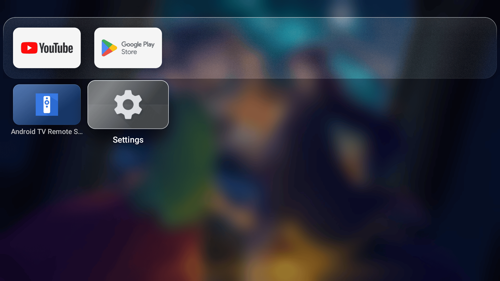

# GlassOS for Fire TV

A calm, glassy home screen for Amazon Fire TV, inspired by tvOS. GlassOS replaces the Fire TV home with a
rotating Top Shelf of what is trending on your streaming services, a frosted shelf of your favourite apps, a full
app drawer and a Control Center, all driven with the remote's D-pad.

GlassOS is free software under the GNU GPL v3.

## Screenshots


| | |
|---|---|
|  |  |
| Control Center (Menu) | Settings |
|  |  |
| App drawer | First-run setup, one-tap permissions |

Taken on the Android TV emulator at 1920x1080, which has only a few apps installed. Top Shelf art from TMDB.

## Features

- **Top Shelf**: full-screen art of trending series and films, with title logos. Titles on the streaming apps you
  have installed (Netflix, Prime Video, Disney+, Apple TV+, Max and others) come first, for the country you
  choose. OK on a title opens its app.
- **Glass shelf**: up to six favourite apps on a frosted glass shelf, with the first row of the app drawer peeking
  in below it. Long press OK on any app to add it to the top row or remove it; Settings > Edit top row moves them.
- **App drawer**: every installed app, with labels, a scroll below the shelf.
- **Adaptive profile pill**: the time and your avatar in the top right, with a tint that adapts to the art behind it.
- **Control Center** (Menu, or OK on the pill): Sleep, Wi-Fi, Do Not Disturb, Audio, a sleep timer, Controllers,
  Accessibility, Parental Controls, Now Playing (while something plays) and VPN (while a VPN is on).
- **Comes back after Home**: GlassOS watches for the Fire TV home and covers it, so the Home button lands in GlassOS.
- **Starts at boot**, with the Fire TV boot logo handled correctly.
- **First-run setup**: your name (on-screen keyboard), an optional profile photo, your country, your top-row apps
  and one-tap permissions.
- Built-in procedural scenes (night desert, dusk ocean, aurora, dark) when there is no network, or your own
  photos from the Pictures/Glass folder.

## Install

GlassOS is not in the Amazon Appstore. Install the APK from the
[Releases](https://github.com/AbhishekKaisar/glassos-firetv/releases) page.

### With Downloader

1. On the Fire TV: Settings > My Fire TV > Developer options, turn on **Apps from Unknown Sources** (or, on newer
   Fire OS, **Install unknown apps** for Downloader).
   No Developer options? Open Settings > My Fire TV > About and press OK on your device name 7 times.
2. Install **Downloader** from the Appstore, open it and enter the APK's URL from the Releases page.
3. Install, then open GlassOS. Setup starts on its own.

### With adb from a computer

```sh
adb connect <tv-ip>:5555
adb install GlassOS-v1.0.0.apk
adb shell am start -n io.github.abhishekkaisar.glassos/.MainActivity
```

## One-tap permission setup

A few features need permissions that Fire OS only grants over ADB. GlassOS can grant them to itself, once, using
the TV's own ADB:

1. Settings > My Fire TV > Developer options: turn on **ADB debugging**.
2. In GlassOS setup (or Settings > Permissions), choose **Set Up**.
3. The TV asks "Allow USB debugging?". Tick **Always allow from this computer** and choose **Allow**.

GlassOS connects to `127.0.0.1:5555` with its own key, runs the grant commands on itself and shows a tick next to
each permission. You can turn ADB debugging off again afterwards. Every feature works without its permission, with
less:

| Permission | Used for | Without it |
|---|---|---|
| Usage access | Noticing the Fire TV home after the Home button | Home goes to the Fire TV home; open GlassOS from your apps |
| Display over other apps | Showing GlassOS at once after Home | GlassOS still comes back, a moment later |
| Notification access | Now Playing and Do Not Disturb | Those tiles are hidden or open Fire TV settings |
| Device admin | Sleep and the sleep timer | Sleep opens the Fire TV sleep menu |
| Storage | Your profile photo and own backgrounds | The glass avatar and built-in scenes |

GlassOS reads no notifications: notification access is only how Android lets an app see media sessions.

### Manual grants

If you prefer a computer, these are the same grants:

```sh
P=io.github.abhishekkaisar.glassos
adb shell appops set $P GET_USAGE_STATS allow
adb shell appops set $P SYSTEM_ALERT_WINDOW allow
adb shell cmd notification allow_listener $P/$P.MediaListener
adb shell dpm set-active-admin $P/.AdminReceiver
adb shell pm grant $P android.permission.READ_EXTERNAL_STORAGE
```

That notification command is for Fire OS 7 and later. On Fire OS 5 and 6 use
`adb shell settings put secure enabled_notification_listeners $P/$P.MediaListener` instead, and if another app
already has notification access, append to the list with a colon rather than replacing it (check first with
`adb shell settings get secure enabled_notification_listeners`).

## Top Shelf sources

Choose in Settings > Top Shelf:

- **TMDB** (default): trending titles from [TMDB](https://www.themoviedb.org/), preferring those on your installed
  streaming services in your country. Refreshed at most every 6 hours and cached for offline use.
- **Apple TV (unofficial)**: the featured titles of the Apple TV app's web catalogue. Unofficial and off by default;
  it may stop working at any time.
- **Built-in scenes**: no network at all.

When a source has no art (no network, no key), the background chosen under "When Top Shelf art is unavailable" is
shown.


This product uses the TMDB API but is not endorsed or certified by TMDB. Streaming availability comes from TMDB's
watch provider data (powered by JustWatch).

### Building with your own TMDB key

Release builds include a TMDB key. To build your own, get a free API key at
[themoviedb.org](https://www.themoviedb.org/settings/api) and put it in `local.properties`:

```properties
tmdb.apiKey=your_v3_api_key
```

or set the `TMDB_API_KEY` environment variable. Without a key, the Top Shelf shows the built-in scenes; a key can
also be typed in Settings > TMDB API key.

## Limitations on Fire OS

- **Home takes about a second.** Fire OS does not let apps replace its home. GlassOS notices the Fire TV home and
  covers it, which takes about 0.8 to 1.8 seconds after Home from another app (no visible change when you press
  Home inside GlassOS).
- **Some Fire TV settings pages are locked** to Amazon's own apps (Display & Audio, Accessibility, Parental
  Controls, the profile picker, Amazon search). For those, GlassOS opens the Fire TV Settings grid and tells you
  which tile to choose.
- **Opening a title**: TMDB has no app-specific title ids, so OK on a TMDB title opens the streaming app rather than
  the title itself.
- **Alexa and the remote's app buttons** still open Amazon's screens.

### Tested on

- Fire TV Stick 4K (Fire OS 6, API 25): the private build this release comes from, daily use.
- Android TV emulator (API 31) for the public build: see the release notes for what was checked there.

Fire OS 7 and 8 devices should work; reports are welcome.

## Uninstall and restore the Fire TV home

GlassOS changes nothing in Fire OS itself, so removing it brings everything back:

- **Keep it, but use the Fire TV home**: GlassOS Settings > Replace Fire TV home: **Off**.
- **Remove it**:
  1. GlassOS Settings > **Prepare to uninstall**. This removes GlassOS's device admin (Android blocks uninstalling
     an active device admin) and stops it covering the Fire TV home.
  2. Fire TV Settings > Applications > Manage Installed Applications > GlassOS > **Uninstall**, or from a computer:
     `adb uninstall io.github.abhishekkaisar.glassos`.

## Building

Requirements: JDK 17 and the Android SDK (platform 34, build tools 34.0.0).

```sh
./gradlew assembleDebug        # app/build/outputs/apk/debug/app-debug.apk
./gradlew assembleRelease      # minified with R8; signed if a keystore is configured (see CONTRIBUTING.md)
```

## Licence

GNU General Public License v3.0. See [LICENSE](LICENSE).

---

Not affiliated with or endorsed by Amazon or Apple. Fire TV is a trademark of Amazon.com, Inc.
